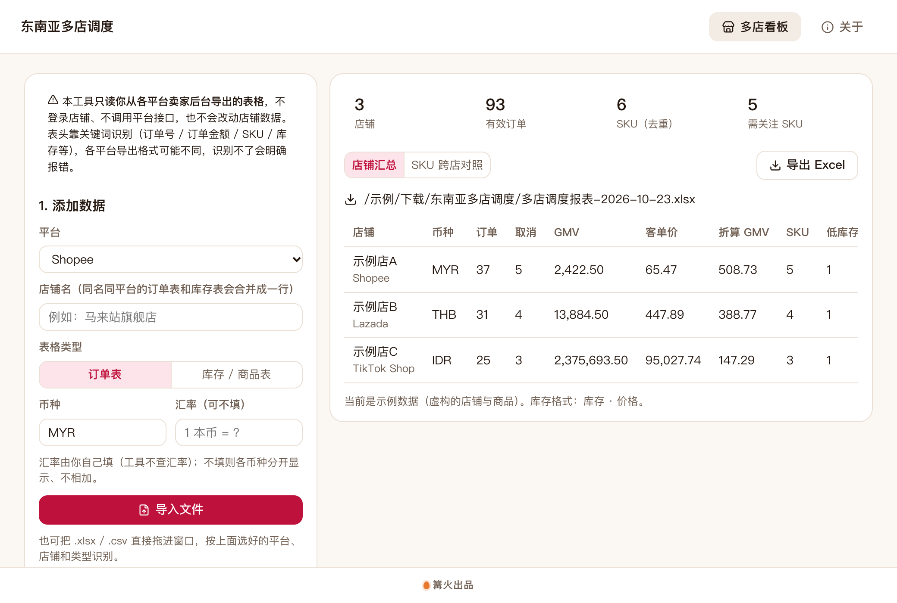

# 东南亚多店调度

> 篝火出品 · 收录于篝火 App 应用区

Lazada / Shopee / TikTok 多店统一管理：导入各店卖家后台导出的订单表和库存表，合并看业绩、库存与跨店差异，导出 Excel。

> **范围说明（风险等级：中）**：本工具**不登录店铺、不调用任何平台开放接口、不改动店铺数据**，只读你自己从卖家后台导出的 .xlsx / .csv。因此不会有账号授权或封号风险；上游 easycb-go 是调用平台开放接口的 Go 封装，本工具没有使用它的代码，也没有对接任何平台接口（未核实各平台接口的申请条件与限制）。各平台后台的导出表头格式未逐一核实，工具靠关键词识别，识别不了会明确报错。



## 下载

到 [Releases](https://github.com/campfire-code/sea-multistore/releases/latest) 下载对应安装包：

| 电脑 | 文件 |
|---|---|
| Windows 10 / 11 | `sea-multistore_版本号_windows-x64-setup.exe` |
| Mac（Apple 芯片） | `sea-multistore_版本号_mac-arm64.dmg` |
| Mac（Intel 芯片） | `sea-multistore_版本号_mac-x64.dmg` |

第一次打开：
- **Windows**：如果弹出「Windows 已保护你的电脑」，点「更多信息」→「仍要运行」。
- **Mac**：如果提示「无法验证开发者」，打开「系统设置 → 隐私与安全性」，在下方点「仍要打开」。

## 怎么用

1. 在左侧选平台（Shopee / Lazada / TikTok Shop / 其他），填店铺名、币种；表格类型选「订单表」或「库存 / 商品表」。
2. 点「导入文件」，或把 .xlsx / .csv 拖进窗口（每次导入都按当前选好的平台、店铺名、类型识别）。一家店的订单表和库存表分两次导入，店铺名相同就会合并成一行。
3. 汇率可选：你自己填「1 本币 = ? 统一币种」（工具不查汇率）。不填时各币种分开显示、不相加。
4. 右侧「店铺汇总」看有效订单、取消单、GMV、客单价、SKU 数、低库存与断货；「SKU 跨店对照」按 SKU（不分大小写）把各店库存与价格摆在一起，并给出提示。
5. 左下「提醒线」设低库存件数（默认 ≤10）和价差百分比（默认 20%），均为可调的参考值，不是平台规则。
6. 点「导出 Excel」，文件保存在「下载」文件夹的「东南亚多店调度」目录，含「店铺汇总」「SKU 对照」「说明」三张表。

识别与口径（均由本工具定义，不代表平台口径）：
- 订单表必须能找到「订单号」和「订单金额」列（中英文关键词，如 订单编号 / Order ID / 订单金额 / Paid Price）；有「状态」列时，含 取消 / 退款 / cancel / refund / 关闭 / 失败 等字样的订单不计入 GMV 和客单价。
- 同一订单号出现多行只算一单，金额取第一行，**视为订单级金额**。如果你的导出表金额是商品行级别，需要先自行汇总。
- 库存表必须能找到 SKU（商家编码 / 货号 / SKU）和库存列；同 SKU 重复行库存相加。
- 价差只在币种相同的店铺之间比较，不做汇率换算。

## 验收用例

示例文件均为虚构数据，放在 `samples/`：

1. 选 Shopee，店铺名填「示例店A」，类型「订单表」，币种 MYR，导入 `shopee-示例店A-订单.csv`。应得到：提示「4 单」；店铺汇总里有效订单 3、取消 1、GMV 201.40、客单价 67.13（重复的 示例A004 只算一单）。
2. 选 Lazada，店铺名「示例店B」，币种 THB，导入 `lazada-示例店B-订单.csv`（英文表头）。应得到：有效订单 3、取消 1、GMV 2,630.00；因两店币种不同且没填汇率，上方出现「GMV 不会相加」的提示。
3. 回到 Shopee「示例店A」，类型改「库存 / 商品表」，币种 MYR，导入 `shopee-示例店A-库存.csv`；再选 Lazada「示例店B」库存表，币种 THB，导入 `lazada-示例店B-库存.csv`。应得到：SKU（去重）5 个；示例店A 低库存 1（DEMO-BAG）、断货 1（DEMO-CUP）。
4. 打开「SKU 跨店对照」：DEMO-CUP 提示「部分店铺断货，其他店有货」；DEMO-BAG、DEMO-STAND 提示「部分店铺低库存」；DEMO-LAMP 无提示。（两店币种不同，不比价。）
5. 把示例店A 的 `shopee-示例店A-订单.csv` 再导入一次并在汇率填 1.05（先在左侧清空再导）：店铺汇总多出「折算 GMV」列，值为 GMV × 1.05。
6. 点「导出 Excel」：得到 `多店调度报表-日期.xlsx`，含三张表；首行加粗冻结。
7. 导入一个表头不含「订单金额」的订单表：应报错并列出表头，不会写入任何数据。

## 自己编译

需要 Node.js 22、pnpm、Rust。

```bash
pnpm install
pnpm test          # 单元测试
pnpm tauri dev     # 开发运行
pnpm tauri build   # 打包
```

界面框架在 `src/kit`（所有 campfire-code 工具共用），本工具的逻辑在 `src/tool`。

## 致谢

本工具的需求参考开源项目 [easycb/easycb-go](https://github.com/easycb/easycb-go)（MIT，Lazada / Shopee / TikTok 等开放平台的 Go 封装）。本工具未使用其代码。

## 归属

本工具由**篝火**出品，是篝火 App 应用区收录的开源工具之一，由篝火（GitHub 组织 [campfire-code](https://github.com/campfire-code)）维护与更新。全部工具的目录见 [toolkit-hub](https://github.com/campfire-code/toolkit-hub)。

## 许可证

MIT，版权方为篝火（campfire-code）。
